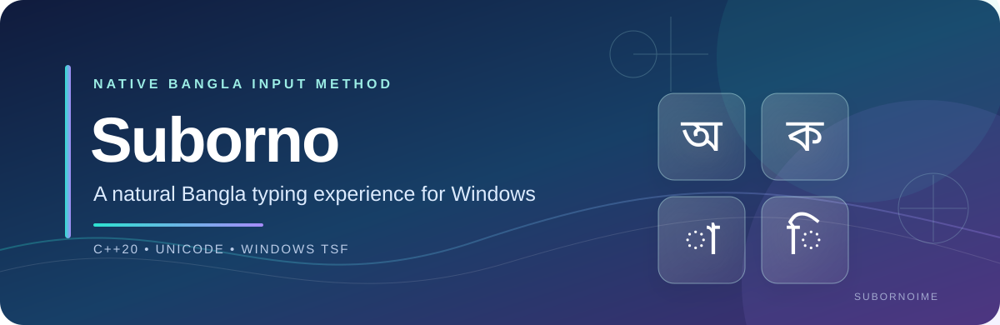
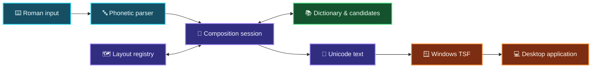

<div align="center">
  

  <br />

  <a href="https://github.com/jubayerhossaingalaxy/SUBORNOIME">
    
  </a>
  <a href="https://github.com/jubayerhossaingalaxy/SUBORNOIME/commits/main">
    
  </a>
  <a href="LICENSE">
    
  </a>
  <br />
  
  
  
  
  

  <br /><br />

  

  <p><strong>A native Bangla input method for Windows, built with modern C++.</strong></p>
  <p>Phonetic composition · Multiple keyboard layouts · Unicode-aware text · Native Windows TSF</p>

  <a href="docs/architecture/overview.md">📐 Architecture</a>
  &nbsp;·&nbsp;
  <a href="docs/development/windows.md">🪟 Windows guide</a>
  &nbsp;·&nbsp;
  <a href="CONTRIBUTING.md">🤝 Contributing</a>
  &nbsp;·&nbsp;
  <a href="https://github.com/jubayerhossaingalaxy/SUBORNOIME/issues">🐛 Report an issue</a>
</div>

---

## 🌟 About Suborno

**Suborno** is a native Bangla input method project focused on a dependable Windows typing experience. It combines a portable C++20 text engine with a Windows **Text Services Framework (TSF)** integration.

The application is named **Suborno**. The repository and technical project identifier is **`subornoime`**.

> 🚧 **Development status:** Active development. The Windows x64 application, engine, and TSF integration are implemented in the repository. Automated builds and tests cover important code and COM/TSF contracts. Interactive typing in everyday desktop applications and clean-machine installation still need manual verification.

## ✨ Features

<table>
  <tr>
    <td width="50%">
      <h3>⌨️ Bangla phonetic engine</h3>
      <p>Roman-token parsing, composition state, and ranked alternatives for a natural typing workflow.</p>
    </td>
    <td width="50%">
      <h3>🗺️ Multiple keyboard layouts</h3>
      <p>Separate layout implementations for Phonetic, Probhat, and National input.</p>
    </td>
  </tr>
  <tr>
    <td>
      <h3>🔤 Unicode-aware text</h3>
      <p>UTF-8 validation, NFC/NFKC normalization, and extended grapheme-cluster handling.</p>
    </td>
    <td>
      <h3>📚 Dictionary and candidates</h3>
      <p>SQLite-backed dictionary storage with candidate generation and ranking infrastructure.</p>
    </td>
  </tr>
  <tr>
    <td>
      <h3>🪟 Native Windows integration</h3>
      <p>A C++ desktop application and an in-process COM/TSF text-service DLL.</p>
    </td>
    <td>
      <h3>⚙️ Settings and persistence</h3>
      <p>User settings and file-persistence support, kept separate from the text engine.</p>
    </td>
  </tr>
</table>

These describe the code and components in this repository; they are not a claim that every interactive Windows workflow has already been validated.

## 🧩 How it fits together

The following is a simplified view of the typing path and the supporting engine components.



## 🖥️ Platform support

| Platform | Status | Notes |
|---|---|---|
| 🪟 **Windows 10/11 x64** |  | Main application and production target. Uses MSVC v143, Win32, COM, and TSF. |
| 🐧 **Ubuntu 24.04 x86_64** |  | Development and CI platform for the portable C++ engine and tests; not a supported Linux input method. |
| 🍎 **macOS** |  | No user-facing input method adapter yet. |
| 🤖 **Android** |  | No user-facing input method yet. |

The core is kept separate from platform-specific integration so future adapters can be developed without coupling the engine to Windows APIs.

## 🚀 Getting started

### 🪟 Build on Windows

**Requirements**

- Windows 10/11 x64
- Visual Studio 2022 or Build Tools with the **MSVC v143** toolset
- Windows SDK
- CMake 3.25 or newer
- Git
- A vcpkg checkout at the baseline pinned in `vcpkg.json`

Open a Visual Studio Developer terminal, or a terminal with the MSVC build environment available, then run these commands from the repository root:

```powershell
# Point this to your existing vcpkg checkout.
$env:VCPKG_ROOT = "D:\path\to\vcpkg"

# Configure the Windows x64 build.
cmake --preset windows-msvc

# Build the Release targets using one job.
cmake --build --preset windows-msvc-release --parallel 1

# Run the Release test suite.
ctest --preset windows-msvc-release --output-on-failure
```

> ℹ️ The Windows production build intentionally requires **MSVC v143**. MinGW, GCC, MSYS2, and clang-cl are not supported for this target.

For installer, registration, and manual verification details, see the [Windows build and verification guide](docs/development/windows.md).

### 🐧 Build the portable engine on Ubuntu

Ubuntu 24.04 is used to develop and validate the platform-neutral C++ code. The bootstrap script prepares the required tools and pinned vcpkg checkout.

```bash
# One-time setup
scripts/bootstrap-ubuntu.sh
export PATH="$HOME/.local/bin:$PATH"
export VCPKG_ROOT="$HOME/.cache/suborno/vcpkg"

# Configure, build, and test
scripts/configure-ubuntu.sh
scripts/build-ubuntu.sh
scripts/test-ubuntu.sh

# Optional quality checks
scripts/check-format-ubuntu.sh
scripts/check-tidy-ubuntu.sh
```

Build scripts use one job by default to keep memory use modest. To choose a different job count for the build script, set `SUBORNO_JOBS` to a positive integer.

See the [Ubuntu development guide](docs/development/ubuntu.md) for setup details and optional tooling.

## 🧪 Tests and verification

The project uses **CMake Presets** and **CTest**.

Automated tests cover areas including:

- Phonetic parsing, composition, and candidate alternatives
- Probhat and National layout mappings
- Bengali Unicode validation, normalization, and grapheme handling
- Dictionary, settings, and persistence behavior
- Portable engine and integration contracts
- Windows DLL loading, COM activation contracts, and TSF registration routines

**What still needs hands-on verification:** live typing through Windows TSF in applications such as Notepad, compatibility with other desktop applications, and installation/uninstallation on a clean Windows machine. Passing a build or a non-interactive test does not prove those scenarios work.

<div align="center">
  <a href="https://github.com/jubayerhossaingalaxy/SUBORNOIME/actions">
    
  </a>
</div>

## 📁 Project structure

```text
subornoime/
├── include/suborno/       # Public C++ headers and API
├── src/
│   ├── core/              # Shared engine and public C API
│   ├── unicode/           # Bengali and Unicode utilities
│   ├── layouts/           # Phonetic, Probhat, and National layouts
│   ├── dictionary/        # Dictionary infrastructure
│   ├── candidates/        # Candidate generation and ranking
│   └── platform/windows/  # Windows app, COM, and TSF adapter
├── tests/                 # Unit, integration, and Windows contract tests
├── cmake/                 # CMake modules and build configuration
├── scripts/               # Build and developer scripts
└── docs/                  # Architecture, specifications, and guides
```

For a deeper explanation, start with the [architecture overview](docs/architecture/overview.md).

## 🤝 Contributing

Contributions and thoughtful bug reports are welcome! Before changing behavior, please read the relevant architecture and specification documents so changes remain consistent with the engine's platform boundaries and phonetic rules.

- [Contribution guide](CONTRIBUTING.md)
- [Architecture overview](docs/architecture/overview.md)
- [Bengali Unicode specification](docs/specifications/bengali-unicode-support.md)
- [Phonetic mapping specification](docs/specifications/phonetic-mapping-spec.md)
- [Security policy](SECURITY.md)

Please include steps to reproduce a bug and the expected versus actual behavior. For code changes, run the relevant tests and checks where your development environment supports them.

## 📦 Dependencies

| Dependency | Purpose |
|---|---|
| [ICU4C](https://icu.unicode.org/) | Unicode handling and normalization |
| [SQLite](https://www.sqlite.org/) | Dictionary storage |
| [WIL](https://github.com/microsoft/wil) | Windows integration utilities |
| [GoogleTest](https://github.com/google/googletest) | Unit and integration testing |
| [Google Benchmark](https://github.com/google/benchmark) | Optional benchmarking |

See [THIRD_PARTY_NOTICES.md](THIRD_PARTY_NOTICES.md) for dependency versions, licenses, and upstream links.

## 📄 License

Suborno is released under the [MIT License](LICENSE).

---

<div align="center">
  <h3>💛 Made for a better Bangla typing experience.</h3>
  <p>Built with care, modern C++, and a focus on Unicode correctness.</p>
  <a href="https://github.com/jubayerhossaingalaxy/SUBORNOIME">
    
  </a>
</div>
